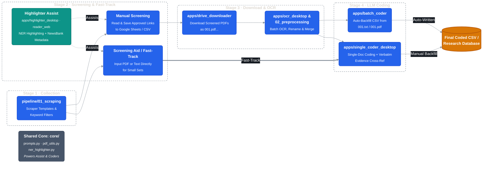
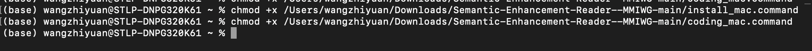

# Tribe News Extractor, Filter & MMIWG Semantic Coding Suite

An end-to-end, open-source archival research monorepo designed for collecting Indigenous/tribal newspaper archives, performing OCR and keyword filtering, highlighting named entities in PDFs, and executing LLM-assisted qualitative & quantitative coding (with a focus on Missing and Murdered Indigenous Women and Girls — MMIWG — media coverage research).

> [!TIP]
> **Looking to run the pre-built desktop apps (`.exe` / `.app`) without installing Python?**
> See the **[End-User Guide (docs/USER_GUIDE.md)](./docs/USER_GUIDE.md)** for Release downloads, UI screenshots, and step-by-step researcher instructions.
> Sample anonymized newspaper PDFs and demo CSVs for testing are reserved under **[examples/](./examples/README.md)**.

---

## Architecture Overview



---

## Repository Structure

```text
├── core/                         # Shared core modules (Single Source of Truth)
│   ├── prompts.py                # Unified Part 1–4 MMIWG Codebook (BATCH_PROMPTS & WEB_PROMPTS)
│   ├── pdf_utils.py              # PyMuPDF text extraction, path cleaning & NewsBank metadata parser
│   └── ner_highlighter.py        # spaCy NER PDF annotation engine
│
├── apps/                         # Desktop & Web applications (packaged via CI or run from source)
│   ├── drive_downloader/         # PySide6 desktop app for batch Google Drive PDF downloads
│   ├── ocr_desktop/              # Flet desktop app for batch OCR (Built-in RapidOCR + optional brew/winget)
│   ├── batch_coder/              # PySide6 desktop app for multi-threaded CSV + PDF/TXT coding
│   ├── single_coder_desktop/     # Flet desktop app for single-article coding with verbatim evidence cross-ref
│   ├── highlighter_desktop/      # Flet desktop app for PDF NER highlighting (on-demand sm/md/lg models)
│   └── reader_web/               # Streamlit web highlighter (en_core_web_trf; source/ZIP install required)
│
├── pipeline/                     # Researcher CLI & batch automation scripts
│   ├── 01_scraping/              # Scraper templates, HTML extractor, keyword/microfilm filters & OS scripts
│   └── 02_preprocessing/         # CSV downloader, file renamer, batch OCR & PDF->MD scripts
│
├── examples/                     # Sample anonymized newspaper PDFs & demo CSVs for testing
├── legacy/                       # Archived scripts kept for historical reference
├── docs/                         # End-User Guide, screenshots, and visual documentation assets
└── .github/workflows/            # CI/CD build workflows (PyInstaller & flet pack)
```

---

## Part 1: Applications Architecture & Build Targets (`apps/`)

All applications share the canonical codebook and PDF/NER utilities in `core/`. The five desktop applications are compiled into standalone `.exe` (Windows) and `.app.zip` (macOS) binaries via [`.github/workflows/build_apps.yml`](./.github/workflows/build_apps.yml); end-users do not need Python or `pip` to run them.

| Module | Framework | Entry Point | Release Binary | Technical Notes |
| :--- | :--- | :--- | :--- | :--- |
| `apps/drive_downloader` | PySide6 | `main.py` | `DriveDownloader` | Streams public Google Drive links from CSV into zero-padded `001.pdf` files. |
| `apps/ocr_desktop` | Flet | `main.py` | `OCRProcessor` | Hybrid OCR engine (`ocr_engine.py`): ships zero-dependency `RapidOCR` + `PyMuPDF` fallback for machines without Homebrew/winget, and auto-upgrades to `Ghostscript + OCRmyPDF` or `Tesseract` when installed (with one-click `brew`/`winget` installer). |
| `apps/batch_coder` | PySide6 | `main.py` | `BatchCoder` | Multi-threaded Gemini coder using `BATCH_PROMPTS`; supports dual-key rotation, `.txt`-over-`.pdf` priority, and incremental CSV resume. |
| `apps/single_coder_desktop` | Flet | `main.py` | `SingleCoder` | Fast-track single-article coder using `WEB_PROMPTS` (or `BATCH_PROMPTS`) with live verbatim quote verification against source text and JSON export. |
| `apps/highlighter_desktop` | Flet | `main.py` | `Highlighter` | On-demand `en_core_web_sm` / `md` / `lg` wheel downloader (`model_manager.py`, no `pip` required in frozen binaries); stores models in `~/Documents/MMIWG_Models` (user-configurable) and extracts 11-column NewsBank metadata. |
| `apps/reader_web` | Streamlit | `semantic_highlighter.py` | *Source / ZIP only* | Retained for `en_core_web_trf` (PyTorch + ~500 MB weights, too large for `.exe`/`.app` bundling). |

### Running Desktop Apps from Source (Developers)

To run or debug any desktop app locally from Python source:

```bash
pip install -r apps/<app_name>/requirements.txt
python apps/<app_name>/main.py
```

*(Replace `<app_name>` with `drive_downloader`, `ocr_desktop`, `batch_coder`, `single_coder_desktop`, or `highlighter_desktop`. Builds for Windows and macOS can be triggered manually via `Actions → Build Cross-Platform Desktop Apps`.)*

### Running `apps/reader_web` (`en_core_web_trf` Transformer Model)

Because `en_core_web_trf` requires PyTorch and ~500 MB transformer weights, `apps/reader_web` is run locally from a cloned repository or downloaded ZIP:

1. **Clone or Download ZIP**: `git clone https://github.com/ZW-Duran/MMIWG-Archival-Coding-Suite.git` (or **Code → Download ZIP**).
2. **macOS**: Double-click `apps/reader_web/scripts/install_mac.command` to create `.venv`, install dependencies, and download `en_core_web_trf`, then launch with `run_highlighter_mac.command`.
   * *Permissions*: Executable permissions (`+x`) for all `.command` and `.sh` scripts are pre-configured in Git (`100755`). If you downloaded a ZIP archive and encounter a permission error, run:
     ```bash
     chmod +x apps/reader_web/scripts/*.command
     ```
     
3. **Windows**: Double-click `apps/reader_web/scripts/install_win.bat`, then launch with `run_highlighter_win.bat`.
4. **Reverse Proxy / Public Deployment Note (Developers)**: The `Access Code` gate in `apps/reader_web/semantic_highlighter.py` is commented out by default for local use. If you deploy this Streamlit app behind a reverse proxy or expose it publicly, uncomment the `access_code` block in `semantic_highlighter.py` to require a password.

---

## Part 2: Data Collection & CLI Preprocessing Pipeline (`pipeline/`)

### Stage 1: Scraping & Filtering (`pipeline/01_scraping/`)

| Module / Script | Target / Purpose |
| :--- | :--- |
| `scrapers/html_clipboard_extract.py` | Extracts PDF links from raw HTML snippets or clipboard source. |
| `scrapers/templates/yearly_archive_template.py` | Developer template for scraping PDFs organized by per-year archive pages. |
| `scrapers/templates/paginated_archive_template.py` | Developer template for scraping PDFs across numbered pagination pages. |
| `scrapers/templates/seasonal_archive_template.py` | Developer template for scraping PDFs from year + season URL slugs. |
| `scrapers/templates/wp_uploads_bruteforce_template.py` | Developer template for probing WordPress `wp-content/uploads/` by sequential issue numbers or month/year filename patterns. |
| `scrapers/templates/wp_monthly_uploads_template.py` | Developer template for probing WordPress `wp-content/uploads/YYYY/MM/` monthly directories. |
| `filters/keyword_filter.py` | Multiprocessing PyMuPDF filter matching gender/violence/Indigenous/MMIWG regex rules and highlighting hits. |
| `filters/microfilm_filter.py` | Preserves subdirectory hierarchy while filtering and highlighting scanned microfilm PDFs. |
| `scripts/check_links.sh` | Verifies HTTP 200 status for extracted `pdf_links.txt` entries. |

Platform-specific one-click wrappers are organized under `pipeline/01_scraping/scripts/mac_linux/` and `pipeline/01_scraping/scripts/windows/`, with runtime folders (`original/`, `relevant/`, `ocred/`) under `pipeline/01_scraping/workspace/`.

---

### Stage 2: CLI Preprocessing & OCR (`pipeline/02_preprocessing/`)

| Script | Purpose |
| :--- | :--- |
| `download_from_csv.py` | CLI script to download screened Google Drive PDFs from `list.csv`. |
| `rename_numbered_pdfs.py` | Normalizes `highlighted_<N>_document.pdf` filenames to zero-padded `001.pdf` format. |
| `highlight_ner.py` | Batch multiprocessing spaCy NER highlighter (`./ocred` → `./highlighted`). |
| `scripts/ocr_batch.command` / `.sh` / `.bat` | CLI `ocrmypdf` batch runners for converting scanned PDFs into searchable text PDFs. |
| `scripts/ocr_and_merge.command` | Runs parallel `ocrmypdf` on `./upload` and merges per-folder PDFs via `pdfunite`. |
| `scripts/pdf_to_markdown.command` | Batch converts OCRed PDFs to Markdown for downstream text processing. |

---

## Shared Core & Legacy Code

* **`core/prompts.py`**: Contains the canonical **Part 1–4** codebook definitions (`BATCH_PROMPTS` and `WEB_PROMPTS`). Any updates to variable definitions or exclusion criteria should be made here once so all apps stay synchronized.
* **`core/pdf_utils.py`**: Shared PyMuPDF text extraction, path sanitization, and 11-column NewsBank metadata parser.
* **`core/ner_highlighter.py`**: Shared spaCy NER PDF annotation engine used by `highlighter_desktop` and `reader_web`.
* **`legacy/`**: Contains superseded scripts (`streamlit_app.py`, `ollama_batch_coder.py`, and `cloud_templates/`) preserved strictly for historical reference.

---

## Important Notices & Data Integrity

> [!CAUTION]
> **API Key Security**: Never commit or share your Google Gemini API keys. Always paste keys at runtime in the GUI sidebar or configure them via environment variables.

> [!WARNING]
> **CSV Backups & Rate Limits**: `apps/batch_coder` writes results back to your target CSV file. Always keep a backup of your master spreadsheet before starting a batch run, and monitor your Gemini API quota/rate limits.

> [!NOTE]
> **System Dependencies for CLI Batch OCR**: `pipeline/02_preprocessing/scripts/ocr_batch.*` and `ocr_and_merge.command` require `ocrmypdf`, `tesseract`, `ghostscript` (`gs`), and `poppler` (`pdfunite`) installed on your system. (For a zero-dependency GUI alternative, use the packaged `OCRProcessor` app from `apps/ocr_desktop`.)

---

## License

This project is licensed under the MIT License — see [LICENSE](LICENSE) for details.
