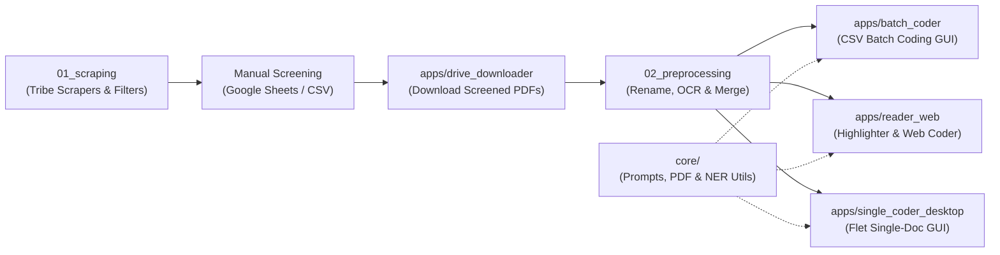

# Tribe News Extractor, Filter & MMIWG Semantic Coding Suite

An end-to-end, open-source archival research monorepo designed for collecting Indigenous/tribal newspaper archives, performing OCR and keyword filtering, highlighting named entities in PDFs, and executing LLM-assisted qualitative & quantitative coding (with a focus on Missing and Murdered Indigenous Women and Girls — MMIWG — media coverage research).

> [!TIP]
> **New here or just want to run the apps?** Read the step-by-step **[End-User Guide (docs/USER_GUIDE.md)](./docs/USER_GUIDE.md)** for Windows & macOS instructions.

---

## Architecture Overview




---

## Repository Structure

```text
├── core/                         # Shared core modules (Single Source of Truth)
│   ├── prompts.py                # Unified Part 1–4 MMIWG Codebook (BATCH_PROMPTS & WEB_PROMPTS)
│   ├── pdf_utils.py              # PyMuPDF text extraction, path cleaning & NewsBank metadata parser
│   └── ner_highlighter.py        # spaCy NER PDF annotation engine
│
├── apps/                         # End-user GUI & Web applications (PyInstaller / Streamlit)
│   ├── drive_downloader/         # PySide6 desktop GUI for batch Google Drive PDF downloads
│   ├── batch_coder/              # PySide6 desktop GUI for multi-threaded CSV + PDF/TXT coding
│   ├── single_coder_desktop/     # Flet desktop GUI for single-article coding
│   └── reader_web/               # Streamlit web suite (Semantic Highlighter & Web Coder)
│
├── pipeline/                     # Researcher CLI & batch automation scripts
│   ├── 01_scraping/              # Tribe-specific scrapers, keyword/microfilm filters & OS scripts
│   └── 02_preprocessing/         # CSV downloader, file renamer, batch OCR & PDF->MD scripts
│
├── legacy/                       # Archived scripts kept for historical reference
├── docs/                         # Screenshots and visual documentation assets
└── .github/workflows/            # CI/CD build workflows
```

---

## Part 1: End-User Applications (`apps/`)

All end-user tools share the unified codebook and PDF utilities in `core/`.

### 1. Drive Downloader (`apps/drive_downloader`)
A cross-platform **PySide6** desktop application for downloading manually screened PDFs from Google Drive URLs listed in a CSV exported from Google Sheets.

* **Entry point**: `apps/drive_downloader/main.py`
* **Run from source**:
  ```bash
  pip install -r apps/drive_downloader/requirements.txt
  python apps/drive_downloader/main.py
  ```


---

### 2. Batch Coder (`apps/batch_coder`)
A cross-platform **PySide6** desktop application for running high-throughput quantitative/qualitative coding across an entire CSV dataset and its corresponding numbered `.txt` / `.pdf` files (`001.txt`, `001.pdf`, etc.) using the Google Gemini API.

* **Key features**: Dual API key rotation (odd/even row alternation), configurable Part 1–4 codebook selection, per-part model selection, and incremental CSV resume support.
* **Entry point**: `apps/batch_coder/main.py`
* **Run from source**:
  ```bash
  pip install -r apps/batch_coder/requirements.txt
  python apps/batch_coder/main.py
  ```


---

### 3. Single-Article Desktop Coder (`apps/single_coder_desktop`)
A lightweight **Flet** desktop GUI for coding individual PDFs or pasted article text without spinning up a browser.

* **Entry point**: `apps/single_coder_desktop/main.py`
* **Run from source**:
  ```bash
  pip install -r apps/single_coder_desktop/requirements.txt
  python apps/single_coder_desktop/main.py
  ```


---

### 4. Web Reader & Coding Suite (`apps/reader_web`)
Two browser-based **Streamlit** applications for interactive reading, semantic highlighting, and evidence-backed single-article coding:

* **`semantic_highlighter.py`**: Uses `spaCy` (`en_core_web_trf`) to highlight custom NER labels (e.g., `PERSON`, `GPE`, `ORG`) directly inside uploaded PDFs and automatically parses NewsBank first-line metadata into an editable table.
  

* **`coding_web.py`**: Interactive Part 1–4 coding interface that returns both quantitative values and verbatim supporting evidence sentences from the article.
  

#### Quick Start (`apps/reader_web`)
* **macOS**:
  1. If needed, grant execute permission to the helper scripts in `apps/reader_web/scripts/`:
     ```bash
     chmod +x apps/reader_web/scripts/*.command
     ```
     
  2. Double-click `apps/reader_web/scripts/install_mac.command` to create `.venv` and install dependencies.
  3. Double-click `apps/reader_web/scripts/run_coding_mac.command` (or run `streamlit run apps/reader_web/semantic_highlighter.py`).
* **Windows**:
  1. Double-click `apps/reader_web/scripts/install_win.bat` to set up `.venv`.
  2. Double-click `apps/reader_web/scripts/run_coding_win.bat` to launch the coding web UI.

> **Note for `semantic_highlighter.py`**: Ensure the spaCy transformer model is installed in your virtual environment:
> ```bash
> python -m spacy download en_core_web_trf
> ```

---

## Part 2: Data Collection & Preprocessing Pipeline (`pipeline/`)

### Stage 1: Scraping & Filtering (`pipeline/01_scraping/`)

| Module / Script | Target / Purpose |
| :--- | :--- |
| `scrapers/chehalis_yearly.py` | Recursive year-based PDF link extractor for Chehalis Tribe newsletters (`chehalistribe.org`). |
| `scrapers/tulalip_paginated.py` | Paginated PDF link extractor for Tulalip News (`tulalipnews.com`). |
| `scrapers/cowlitz_seasonal.py` | Year + season PDF link extractor for Cowlitz Tribe (`cowlitz.org`). |
| `scrapers/puyallup_wp_uploads.py` | WordPress uploads crawler for Puyallup Tribe (`puyalluptribe-nsn.gov`). |
| `scrapers/skokomish_sounder.py` | Sounder newsletter link extractor for Skokomish Tribe (`skokomish.org`). |
| `scrapers/html_clipboard_extract.py` | Extracts PDF links from raw HTML snippets or clipboard source. |
| `filters/keyword_filter.py` | Multiprocessing PyMuPDF filter matching gender/violence/Indigenous/MMIWG regex rules and highlighting hits. |
| `filters/microfilm_filter.py` | Preserves subdirectory hierarchy while filtering and highlighting scanned microfilm PDFs. |
| `scripts/check_links.sh` | Verifies HTTP 200 status for extracted `pdf_links.txt` entries. |

Platform-specific one-click wrappers are organized under `pipeline/01_scraping/scripts/mac_linux/` and `pipeline/01_scraping/scripts/windows/`, with runtime folders (`original/`, `relevant/`, `ocred/`) under `pipeline/01_scraping/workspace/`.


---

### Stage 2: Preprocessing & OCR (`pipeline/02_preprocessing/`)

| Script | Purpose |
| :--- | :--- |
| `download_from_csv.py` | CLI script to download screened Google Drive PDFs from `list.csv`. |
| `rename_numbered_pdfs.py` | Normalizes `highlighted_<N>_document.pdf` filenames to zero-padded `001.pdf` format. |
| `highlight_ner.py` | Batch multiprocessing spaCy NER highlighter (`./ocred` → `./highlighted`). |
| `scripts/ocr_batch.command` / `.sh` / `.bat` | Batch `ocrmypdf` runners for converting scanned PDFs into searchable text PDFs. |
| `scripts/ocr_and_merge.command` | Runs parallel `ocrmypdf` on `./upload` and merges per-folder PDFs via `pdfunite`. |
| `scripts/pdf_to_markdown.command` | Batch converts OCRed PDFs to Markdown for downstream text processing. |

---

## Shared Core & Legacy Code

* **`core/prompts.py`**: Contains the canonical **Part 1–4** codebook definitions (`BATCH_PROMPTS` and `WEB_PROMPTS`). Any updates to variable definitions or exclusion criteria should be made here once so all apps stay synchronized.
* **`legacy/`**: Contains superseded scripts (`streamlit_app.py`, `ollama_batch_coder.py`, and `cloud_templates/`) preserved strictly for historical reference.

---

## Important Notices & Data Integrity

> [!CAUTION]
> **API Key Security**: Never commit or share your Google Gemini API keys. Always paste keys at runtime in the GUI/Web sidebar or configure them via environment variables.

> [!WARNING]
> **CSV Backups & Rate Limits**: `apps/batch_coder` writes results back to your target CSV file. Always keep a backup of your master spreadsheet before starting a batch run, and monitor your Gemini API quota/rate limits.

> [!NOTE]
> **System Dependencies for Batch OCR**: `pipeline/02_preprocessing/scripts/ocr_batch.*` and `ocr_and_merge.command` require `ocrmypdf`, `tesseract`, `ghostscript` (`gs`), and `poppler` (`pdfunite`) installed on your system.

---

## License

This project is licensed under the MIT License — see [LICENSE](LICENSE) for details.
