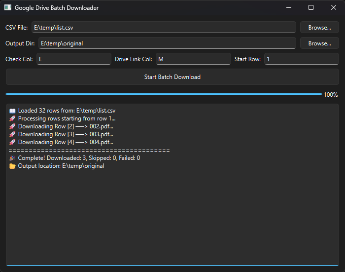
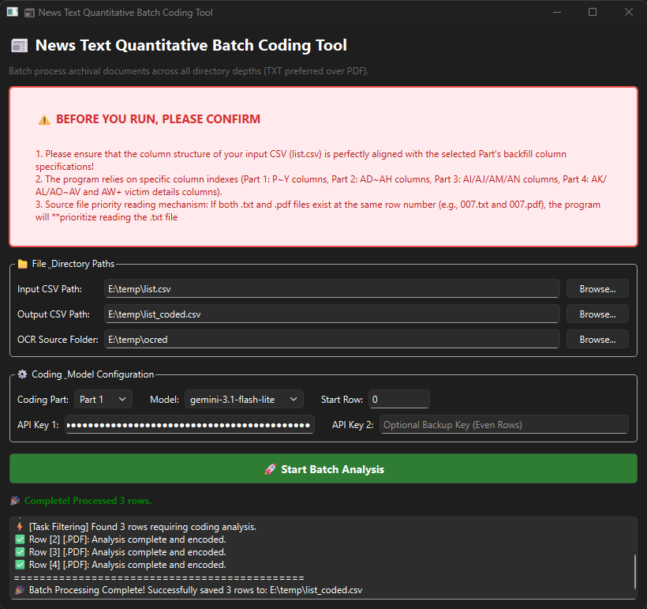
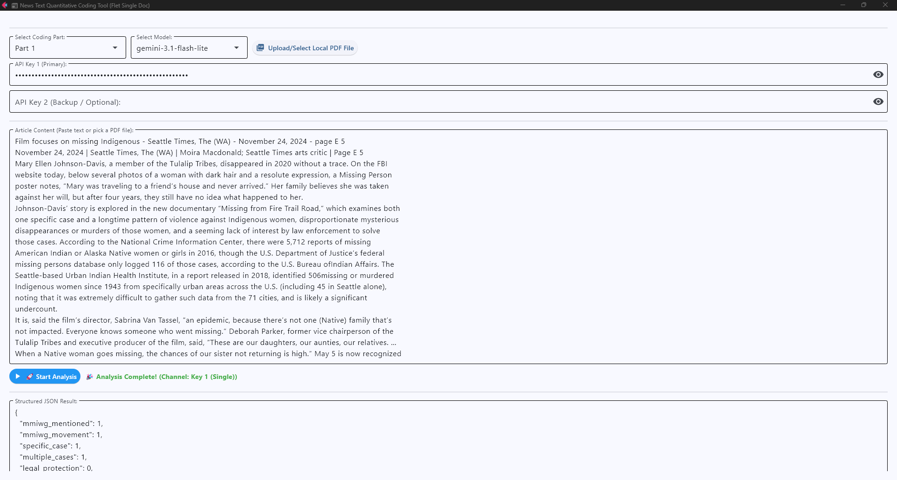
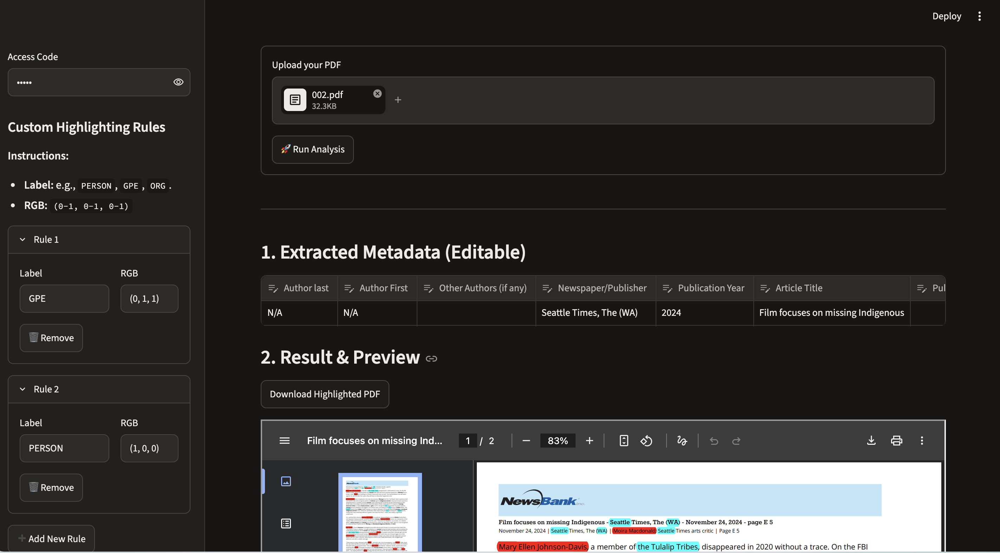

# End-User Guide — MMIWG Archival Reading & Coding Suite (v1.0.0)

Welcome! This guide is written for non-technical researchers, student assistants, and policy analysts who want to **use the desktop or web applications directly**—no programming experience or terminal commands required.

> [!TIP]
> **Developer / Researcher Pipeline**: If you are looking for web scrapers, OCR batch commands, or codebase architecture, see the main [README.md](../README.md).

---

## 1. Quick Start: Choosing the Right Tool

| What do you want to do? | Recommended Tool | Interface Type | Requires API Key? |
| :--- | :--- | :--- | :---: |
| **Download approved PDFs from a Google Sheet CSV** | **Drive Downloader** (`apps/drive_downloader`) | Desktop App | No |
| **Code hundreds of articles automatically into a CSV** | **Batch Coder** (`apps/batch_coder`) | Desktop App | Yes (Gemini) |
| **Code 1 article at a time with instant JSON preview** | **Single Coder** (`apps/single_coder_desktop`) | Desktop App | Yes (Gemini) |
| **Visually highlight people/locations in a PDF** | **Semantic Highlighter** (`apps/reader_web`) | Browser GUI | No |
| **Code 1 article with word-by-word evidence verification** | **Web Coder** (`apps/reader_web`) | Browser GUI | Yes (Gemini) |

---

## 2. Desktop Apps Setup (Windows & macOS)

### Downloading Pre-built Apps
Download the executable for your operating system from the repository's **Releases** tab:
* **Windows**: Download `DriveDownloader-Windows.exe`, `BatchCoder-Windows.exe`, or `SingleCoder-Windows.exe`. Double-click to run.
* **macOS**: Download `DriveDownloader-macOS.zip`, `BatchCoder-macOS.zip`, or `SingleCoder-macOS.zip`. Double-click to unzip, then drag the `.app` to your Applications folder.

### First-Time OS Security Bypass (No Terminal Needed)
Because these open-source tools are built for academic research without a paid Apple/Microsoft commercial signature:
* **Windows**: If blue *Windows protected your PC* appears, click **More info** → **Run anyway**.
* **macOS**: If *cannot be opened because Apple cannot check it* appears:
  1. Hold the **Control key** and click the `.app` icon (or right-click).
  2. Select **Open** from the menu.
  3. Click **Open** in the confirmation dialog.

### Getting a Google Gemini API Key
For the coding tools, you will need a Google Gemini API key:
1. Open [Google AI Studio](https://aistudio.google.com/) in your browser and sign in with any Google account.
2. Click **Get API key** → **Create API key**.
3. Copy the key string and keep it safe. In both `BatchCoder` and `SingleCoder`, you can optionally enter **two keys** (Key 1 and Key 2) to alternate requests across odd/even rows, doubling your speed and preventing rate-limit pauses.

---

## 3. App Guides

### App 1: Drive Downloader (`DriveDownloader`)

**Purpose**: Reads your Google Sheets screening CSV and downloads every approved PDF from its Google Drive link.

#### How It Works (Automatic & Smart)
* **Automatic Header & Blank Row Skipping**: You do **not** need to count or specify row numbers. The app automatically detects and skips header rows (e.g., containing `"Author Last Name"` or `"Newspaper/Publisher"`) and empty lines.
* **Smart Filter & Resume Logic**:
  * **To Download**: If the **Check Column** has a mark (e.g., `1`, `x`, `YES`) and the PDF does not exist locally yet, it downloads the file.
  * **Auto-Skip**: If both the Check Column and Link Column are blank, or if the PDF was already downloaded in a previous session, it is safely skipped without re-downloading.
  * **Start Row (Optional)**: Defaults to `1`. Leave it as `1` to scan from the top, or enter a specific row (e.g., `150`) only if you wish to skip earlier rows completely.

#### File Naming Convention (`000` Format)
The downloader automatically names files using **three-digit zero-padded row indices** (e.g., Row 2 becomes `002.pdf`, Row 35 becomes `035.pdf`, Row 104 becomes `104.pdf`). This exact format is required for downstream batch coding tools.

#### Step-by-Step
1. Export your Google Sheet as a CSV file (`File → Download → Comma Separated Values (.csv)`).
2. Launch **DriveDownloader**.
3. Click **Browse** next to *CSV File Path* and select your `.csv`.
4. Click **Browse** next to *Output Folder* to choose where PDFs should be saved.
5. Enter your column letters:
   * **Check Column** (e.g., `C`): Column containing your human screening decision.
   * **Link Column** (e.g., `F`): Column containing the Google Drive sharing links.
6. Click **Start Download**.

> [!NOTE]
> **Google Drive Permissions**: Ensure your Google Drive links are set to *"Anyone with the link can view"*. If private, Google will return a `403 Forbidden` error.

---

### App 2: Batch Coder (`BatchCoder`)

**Purpose**: Reads an entire CSV and its corresponding pre-extracted articles (`001.txt`, `002.txt`, etc.), analyzes them with Gemini LLM, and backfills qualitative/quantitative coding variables into the CSV.

#### ⚠️ Strict File Naming Requirement
The matching engine looks for files using the **three-digit zero-padded row prefix** (`001`, `002`, `003`...):
* ✅ Supported: `001.txt`, `001.pdf`, `002_document.txt`, `002 Press.pdf`
* ❌ Not Recognized: `1.pdf`, `2.txt`, `article_20.pdf`
*(If your files are named `1.pdf` or `highlighted_1_document.pdf`, use the renaming utility in `pipeline/02_preprocessing/rename_numbered_pdfs.py` first).*

> [!TIP]
> If both `002.txt` and `002.pdf` exist in your folder, `BatchCoder` **automatically prioritizes `.txt`**, ensuring the cleanest raw text without PDF formatting artifacts.

#### Smart Resume & Skip Logic
* **How Rows Are Selected**: For each row, `BatchCoder` checks two conditions:
  1. **Presence Check (Column `E`)**: Must be **non-empty** (typically a column that is always filled whenever an article file exists and needs coding).
  2. **Target Coding Column Check**: The first output column for the selected Part (e.g., `mmiwg_mentioned` for Part 1) must be **empty**.
* **Never Overwrites Existing Work**: If the target coding column already has a value, the row is automatically skipped. You can safely stop and resume anytime.
* **Pro Tip (Batch-Skipping Unwanted Rows with Formulas)**: In Google Sheets or Excel, you can use a formula to intentionally pre-fill the target coding column on unwanted rows (e.g., with `"SKIP"` or `"N/A"`). Because those cells are no longer empty, `BatchCoder` will automatically skip them without wasting API calls.
* **Start Row**: Defaults to `0` (or `1`), which tells the app to check the entire spreadsheet from the beginning and only process un-coded rows.

#### Step-by-Step
1. Launch **BatchCoder**.
2. **File Paths**:
   * **Input CSV**: Select your source CSV.
   * **Output CSV**: Select where results will be written (e.g., `list_coded.csv`).
   * **Source Files Directory**: Select the folder containing your `001.txt` / `001.pdf` files.
3. **Coding Configuration**:
   * **Coding Part**: Select `Part 1` (MMIWG Themes), `Part 2` (Government & Legal Officials), `Part 3` (Academics & Advocates), or `Part 4` (Victims & Suspects Demographics).
   * **Model**: Leave the recommended default (`gemma-4-31b-it` or `gemini-3.5-flash-lite`).
   * **Start Row**: Leave as `0` to process all remaining un-coded rows.
4. **API Keys**: Paste Gemini API Key 1 (and optionally Key 2).
5. Click **Start Batch Coding**.

---

### App 3: Single-Article Desktop Coder (`SingleCoder`)

**Purpose**: Ideal for testing prompts, pilot coding, or coding individual articles without spinning up a web server.

> [!NOTE]
> **Single Coder vs. Web Coder**: Both apps share the exact same underlying MMIWG prompt definitions from `core/prompts.py`.
> * Use **Single Coder (Desktop)** if you want a self-contained `.exe` / `.app` that gives you a clean JSON output immediately.
> * Use **Web Coder (`coding_web.py`)** if you need to see sentence-by-sentence verbatim quotes highlighted side-by-side.

#### Step-by-Step
1. Launch **SingleCoder**.
2. Select your **Coding Part** (`Part 1`–`Part 4`) and **Model**.
3. Paste your Gemini API key.
4. Provide the article content:
   * Click **Upload PDF** to extract text directly from a file, **or**
   * Paste the article text directly into the text box.
5. Click **Run Coding Analysis**.
6. The structured JSON coding matrix will appear at the bottom. Click **Show Raw Output** to view the full model response if needed.

---

### App 4: Web Reader Suite (`apps/reader_web`)

The web suite runs locally inside your web browser (Chrome, Edge, Safari, Firefox).

#### Zero-Command One-Click Setup
You do not need to install packages or download AI models in the terminal:
* **macOS**: Double-click `apps/reader_web/scripts/install_mac.command`.
* **Windows**: Double-click `apps/reader_web/scripts/install_win.bat`.
*(The installer automatically creates the isolated environment, installs all requirements, and downloads the required spaCy model).*

#### 1. Semantic Enhancement Reader (`semantic_highlighter.py`)
**Launch**: Double-click `apps/reader_web/scripts/run_highlighter_mac.command` (macOS) or `apps/reader_web/scripts/run_highlighter_win.bat` (Windows).

* **Access Code**: Enter `MMIWG` in the left sidebar to unlock the application.
* **Custom Entity Highlighting Rules**:
  Enter any standard Named Entity Recognition (NER) tag and its RGB color `(Red, Green, Blue)` between `0` and `1`:
  * `(1, 0, 0)` = Red
  * `(0, 1, 0)` = Green
  * `(0, 0, 1)` = Blue
  * `(0, 1, 1)` = Cyan
  * `(1, 0.65, 0)` = Orange

> [!TIP]
> **Standard NER Tags Reference**: The highlighter uses spaCy's transformer model (`en_core_web_trf`). For the official list of supported entities, see the **[spaCy OntoNotes 5 Named Entity Recognition Specification](https://spacy.io/models/en#en_core_web_trf)**:
> * `PERSON`: People, including fictional characters.
> * `GPE`: Countries, cities, states, tribal reservations.
> * `ORG`: Companies, government agencies, tribal councils, institutions.
> * `DATE`: Absolute or relative dates or periods.
> * `LAW`: Named documents made into laws (e.g., "Savanna's Act", "Senate Resolution 60").
> * `NORP`: Nationalities, religious or political groups (e.g., "Native American", "Navajo").

* **Automatic NewsBank Metadata Extraction**: The app parses the article's header line using date-anchor regex and places the metadata (Author, Publisher, Publication Date, Year) into an **editable spreadsheet** at the top of the page.
* **Inline PDF Preview & Download**: Preview the highlighted PDF in your browser and click **Download Highlighted PDF** to save.

#### 2. Interactive Web Coder (`coding_web.py`)
**Launch**: Double-click `apps/reader_web/scripts/run_coding_mac.command` (macOS) or `apps/reader_web/scripts/run_coding_win.bat` (Windows).

* Paste your Gemini API key in the sidebar.
* Select the coding part (`Part 1:`–`Part 4:`), paste the text, and click **Run Coding**.
* Unlike the desktop version, the web coder displays each coded variable along with the **exact verbatim sentence from the text** used as evidence, allowing researchers to double-check AI decisions immediately.

---

## 4. Summary of One-Click Launcher Scripts

To make things easy for anyone on your team, all web-suite scripts are located in `apps/reader_web/scripts/`:

| Platform | Action | Script to Double-Click |
| :--- | :--- | :--- |
| **macOS** | First-time Setup | `apps/reader_web/scripts/install_mac.command` |
| **macOS** | Launch Web Coder | `apps/reader_web/scripts/run_coding_mac.command` |
| **macOS** | Launch Semantic Highlighter | `apps/reader_web/scripts/run_highlighter_mac.command` |
| **Windows** | First-time Setup | `apps/reader_web/scripts/install_win.bat` |
| **Windows** | Launch Web Coder | `apps/reader_web/scripts/run_coding_win.bat` |
| **Windows** | Launch Semantic Highlighter | `apps/reader_web/scripts/run_highlighter_win.bat` |

*(Note: On macOS, remember to grant initial file permission once by double-clicking or right-clicking if prompted).*

---

## 5. Frequently Asked Questions (FAQ)

**Q: Do I need to re-download the spaCy model every time?**  
A: No. The one-click installer (`install_mac.command` / `install_win.bat`) downloads it once into the `.venv` folder.

**Q: Why was an article skipped during Batch Coding?**  
A: `BatchCoder` only processes rows where Column `E` is **non-empty** and the target coding column is **empty**. If Column `E` is blank, or if the target column already has a value (from an earlier run or a skip placeholder), the row is skipped. Clear the target column in your CSV if you want to re-code it.

**Q: Can I use `BatchCoder` with subfolders?**  
A: Yes! `BatchCoder` recursively searches all subdirectories inside your selected source folder. As long as the filename begins with `001`, `002`, etc., it will locate it regardless of folder depth.
